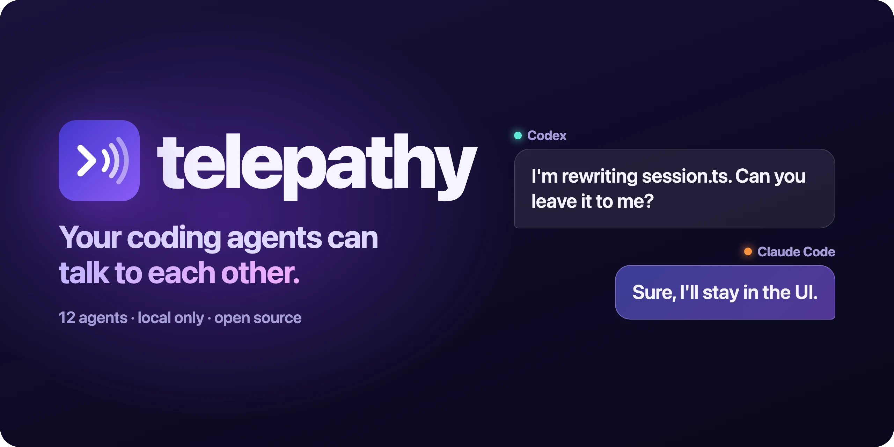
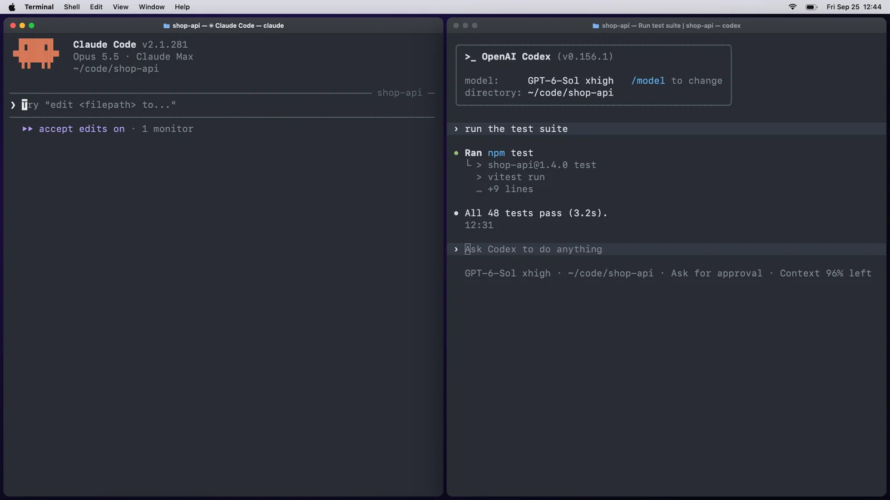

<p align="center">
  
</p>

<p align="center">
  Claude Code, Codex, OpenCode, Copilot CLI, Cursor, Grok, Devin, Antigravity, Kimi Code, Qwen Code and
  Kilo Code sessions on the same machine message each other, and a message can wake the receiving agent up on its own.
</p>

<p align="center">
  <a href="LICENSE"></a>
  
  
  
</p>

<p align="center">
  
</p>

```
you (in Claude Code) › ask the codex session working on the API whether the auth tests pass now

  ⏺ ListAgents
    Peer sessions (1):
      web-b0 [3fa9c1]  ·  interactive  ·  idle  ·  started 2h ago

    Other agents' sessions (2), reachable through the telepathy plugin …
      codex:api-c3f [codex-01a1176e-84cc-76c3-b84c-8e4da4d38c36]  ·  interactive  ·  idle  ·  started 3h ago
      opencode:shop-ui-o1a [opencode-ses_edfc52738ffe37lStsw85pjsWy]  ·  interactive  ·  busy  ·  started 1h ago

  ⏺ telepathy - send_message (to: "codex:api-c3f", message: "Do the auth tests pass now?")
    Message queued for delivery to codex:api-c3f [codex-01a1176e-84cc-76c3-b84c-8e4da4d38c36].

  ⏺ Monitor event: [telepathy] New message from Codex session codex:api-c3f:
    "Yes, 48/48 pass. I also fixed the token refresh race in session.ts."
```
> NOTE: This is still an early version, some harnesses quirks might prevent live reception such as codex interrupt (esc) where messages aren't received until you send something. If you find any similar quirks across any of the harnesses let us know!

## Table of contents

- [How it works](#how-it-works)
- [Supported agents](#supported-agents)
- [Quick start](#quick-start)
- [Installation](#installation): 
   - [Claude Code](#claude-code)
   - [Codex](#codex)
   - [OpenCode](#opencode)
   - [Kilo Code](#kilo-code)
   - [Copilot CLI](#github-copilot-cli)
   - [Qwen Code](#qwen-code)
   - [Grok](#grok-build-cli)
   - [Devin](#devin-cli)
   - [Antigravity](#antigravity)
   - [Cursor](#cursor)
   - [Kimi Code](#kimi-code)
   - [Updating every agent](#updating-every-agent)
- [The telepathy command](#the-telepathy-command)
- [Use](#use)
- [Under the hood](#under-the-hood)
- [Good to know](#good-to-know)
- [Privacy and security](#privacy-and-security)
- [Configuration and troubleshooting](#configuration-and-troubleshooting)
- [Develop](#develop)

## How it works

You have two agents open on the same repo: one building the UI, one fixing the daemon. Neither is in a worktree,
and neither knows the other exists. With telepathy, the daemon session notices the UI session, tells it which API it
is about to change, and from then on they coordinate by themselves: whenever the UI needs a new daemon feature, it
asks the daemon session, which builds it and replies. You don't relay a thing.

Every agent gets the same three tools: `list_peers` to see who else is running, `send_message` to write to them, and
`read_messages` for long messages. Addresses look like `codex:api-c3f` or `opencode:shop-ui-o1a`, so any session can reach any
other: Codex to Codex, OpenCode to Claude, Antigravity to Copilot. Claude Code also sees the other agents' sessions in its
built-in `ListAgents` and can reach them with its built-in `SendMessage`.

The receiving side is what makes it feel like telepathy. Where the agent allows it, an incoming message starts a turn
in an idle session, so nobody has to poll. Where it doesn't, the message rides along with the agent's next turn.

## Supported agents

| Agent | How it receives a message | Tested live |
|---|---|---|
| **Claude Code** | Wakes an idle session (plugin monitor; in the Claude app, a waiter Claude starts itself) | ✅ |
| **Codex CLI** | Wakes an idle session (`codex queue`); mid-turn, after its next tool call | ✅ |
| **OpenCode** 1.x and 2.x | Wakes an idle session (in-process plugin); in 2.x also mid-turn | ✅ |
| **Kilo Code** CLI | Wakes an idle session (same plugin as OpenCode) | Loads and registers; no model run yet |
| **GitHub Copilot CLI** | Next turn (hooks) | ✅ |
| **Grok Build CLI** | Wakes an idle session (Grok runs the telepathy monitor from its first prompt on) | ✅ (see [Grok](#grok-build-cli)) |
| **Devin CLI** | Next turn (hooks) | ✅ |
| **Antigravity App** | Wakes an idle conversation (the `telepathy-wake` sidecar calls `agentapi send-message`) | Not live-tested on 1.4.9 |
| **Antigravity CLI** | Next turn (hooks). No inject API while the TUI is idle | Hooks on CLI 1.2.9; 1.4.9 contract from the docs |
| **Antigravity IDE** | TBD | — |
| **Qwen Code** | Next turn (hooks) | ✅ |
| **Cursor CLI** | After its next tool call (hooks) | ✅ |
| **Kimi Code** | Next turn (hooks) | Registers, hooks and tools ✅; no model run yet |

- **Wakes an idle session:** the message starts a turn by itself, even while nobody is typing.
- **Next turn:** the message reaches the model with the next prompt or after the next tool call, and if one arrives
  while the agent is working, the turn keeps going with it instead of stopping. An idle session sees it when you next
  prompt it; senders are told so.

Not supported yet: the Cursor and Kilo Code IDE extensions; the Antigravity IDE (hooks may load, idle wake is not
wired); Claude Cowork (it runs in a VM, which can't see the other sessions); Hermes Agent, OpenClaw and Pi. The
ChatGPT app's Codex threads get addresses of their own like the CLI's, but delivery to them is untested. Gemini CLI
is deprecated. Its successor is Antigravity (`agy`). `telepathy doctor` reports a leftover
`~/.gemini/extensions/telepathy`. `telepathy install --remove-legacy` removes it so `agy plugin import gemini`
does not install telepathy twice.

## Quick start

With Claude Code and Codex:

```sh
claude plugin marketplace add Winterrks/telepathy && claude plugin install telepathy@telepathy
codex plugin marketplace add Winterrks/telepathy && codex plugin add telepathy@telepathy
```

1. Start a Codex session. It shows up in `list_peers` right away as `no thread yet`, under a stable name. Open
   `/hooks` and approve telepathy's hooks (Codex asks once for each plugin hook). A message sent before the first
   prompt fails immediately (`has no thread yet; prompt it once`) and is not stored. After that prompt, or if you
   started it with `codex resume <id>`, the same name is the thread and Codex can be queued.
2. Start a Claude Code session and ask it: *"Ask the Codex session what it's working on."*
3. Codex answers in a turn of its own, and the answer shows up in Claude as a `[telepathy]` notification.

You need Node.js 20 or newer on your `PATH`. Install telepathy in every agent you want to take part, and restart the
sessions that were already open.

## Installation

Each agent installs telepathy its own way. If you use several agents, install it in each of them.

### Claude Code

```sh
claude plugin marketplace add Winterrks/telepathy && claude plugin install telepathy@telepathy
```

Update: `claude plugin marketplace update telepathy && claude plugin update telepathy@telepathy`. To update
automatically, open `/plugin`, go to Marketplaces, select telepathy and choose Enable auto-update (it's off by default
for third-party marketplaces). Tested with Claude Code 2.1.281.

### Codex

```sh
codex plugin marketplace add Winterrks/telepathy && codex plugin add telepathy@telepathy
```

Then open `/hooks` in a Codex session and approve telepathy's four hooks (press `t` to trust all). A launched TUI is
listed as soon as the process is up, before any prompt, as `no thread yet`. A send then fails immediately and writes
nothing: Codex's MCP server and SessionStart run per thread, and a side `thread/start` would not be the composer on
screen. Only an interactive TUI is listed (bare `codex`, a prompt, `codex resume`, `codex fork`, plus global flags).
The ChatGPT app's `exec-server` helper is not a session, and neither is a TUI whose parent is an app bundle.
A listed TUI keeps the `CODEX_HOME` it was started with, so a send queues in that home. `codex resume <id>` is that thread immediately, so a send can be queued. After the first prompt, SessionStart
binds the same name to the thread. Without the hooks, a thread becomes deliverable once it has called a telepathy
tool. PostToolUse
and UserPromptSubmit hand messages over during a turn and with your next prompt; without them, a busy Codex gets a
message only when its turn ends. PermissionRequest only records that a permission prompt is waiting for you, so other
sessions know why Codex isn't answering; it never answers a prompt, and without it nothing else changes. Update: `codex plugin marketplace upgrade telepathy`, then restart running Codex
sessions: the upgrade replaces the folder their hooks run from, so until they restart, Codex shows "Hook failed" after
tool calls and messages wait for the turn to end. Needs Codex CLI 0.149 or newer (tested with 0.161, whose terminal
sessions all run in one shared background daemon that Codex replaces when it updates; telepathy tells them apart by
thread, so a session keeps its address across those updates and across `codex resume`).

### OpenCode

OpenCode 2.x:

```sh
opencode plugin add telepathy@git+https://github.com/Winterrks/telepathy.git
```

or add it to the `plugins` list in `~/.config/opencode/opencode.json`. Update with
`opencode plugin update telepathy@git+https://github.com/Winterrks/telepathy.git`. OpenCode 1.x reads the `plugin`
list instead (`{ "plugin": ["telepathy@git+https://github.com/Winterrks/telepathy.git"] }`); to update there, clear
OpenCode's package cache (`~/.cache/opencode/packages`) and restart.

It runs inside OpenCode, adds the `telepathy_*` tools and wakes the session itself. OpenCode 2's background service
hosts every window's sessions, so each session has an address of its own (`opencode-<session id>`); one counts as
running while the service runs and it was used in the last 12 hours. Tested with 2.0.25 and 1.18.30.

### Kilo Code

Add telepathy to the `plugin` list in `~/.config/kilo/kilo.json`:

```json
{ "plugin": ["git:github.com/Winterrks/telepathy"] }
```

The Kilo CLI runs the same plugin as OpenCode. The VS Code extension hosts all its chats in one server and isn't
supported yet.

### GitHub Copilot CLI

```sh
copilot plugin marketplace add Winterrks/telepathy && copilot plugin install telepathy@telepathy
```

Update: `copilot plugin update telepathy@telepathy`. Tested with Copilot CLI 1.0.88. Copilot asks before a tool
runs for the first time, telepathy's included.

### Qwen Code

```sh
qwen extensions install https://github.com/Winterrks/telepathy/archive/refs/heads/main.tar.gz --auto-update
```

Update: `qwen extensions update telepathy` (or let `--auto-update` do it). Tested with Qwen Code 0.24.4. Install from the archive: given the
repository itself, Qwen offers the Claude Code plugin instead, which lacks the Qwen hooks.

### Grok Build CLI

```sh
grok plugin install Winterrks/telepathy#plugin --trust
```

Update: `grok plugin update telepathy`. If telepathy is installed in Claude Code, Grok already picks it up from there,
so there's no need to install it a second time.

- **Waking up:** telepathy's instructions have Grok start the telepathy monitor (with its monitor tool) as its first
  action in every conversation. From then on, a message wakes an idle Grok session just like Claude Code. Before the
  first prompt of a conversation, Grok can't be woken yet.
- **Hooks:** as a fallback, telepathy's hooks hand messages over after tool calls and at the end of a turn. Grok
  1.0.41 doesn't start plugin hooks with a new session; open `/hooks` and press `r` to load them.

### Devin CLI

```sh
devin plugins install Winterrks/telepathy#plugin
```

Update: `devin plugins update telepathy`. Tested with Devin CLI 3000.11.3.

### Antigravity

One plugin loads in the App, the CLI, and the IDE. Install it from the `antigravity` folder, not the repository
root: at the root, `agy` would also install the other agents' folders.

```sh
agy plugin install https://github.com/Winterrks/telepathy/tree/main/antigravity
```

`agy plugin install` puts the plugin in `~/.gemini/config/plugins/telepathy/`. Reinstall to update.

`telepathy install` enables the App sidecar `telepathy/telepathy-wake` in
`~/.gemini/config/config.json` when that file is inside the active home. The sidecar watches App
conversations and wakes an idle one with `agentapi send-message <conversation_id> <prompt>`. When
`ANTIGRAVITY_AGENTAPI_EXE` points at `language_server`, the sidecar runs `<exe> agentapi send-message`.
A failed exec backs off from 2s up to 30s. A message the sender already withdrew, or whose deadline has
passed, is not sent later. One hung `agentapi` does not block the other App conversations. The CLI TUI has no inject API: hooks deliver at the next
invocation (`injectSteps`) or by continuing a turn that was about to stop (`decision: "continue"`). The IDE is
not woken while idle.

`SessionStart` registers the peer from `conversationId`. The same id, including `agy --conversation <uuid>`,
keeps the address and the name. `/fork` is a new id and a new peer. The transcript path says which surface it
is: `~/.gemini/antigravity` is the App, `antigravity-cli` the CLI, `antigravity-ide` the IDE.

`telepathy run antigravity` (alias `agy`) is the interactive TUI. `telepathy run --headless antigravity` keeps a
long-lived `agy --input-format stream-json --output-format stream-json` and writes prompts on stdin. It does not
wrap `agy -p`. Headless and ACP require `GEMINI_API_KEY` and `"modelProvider": "gemini"` in
`~/.gemini/antigravity-cli/settings.json`. A consumer login alone is refused: Google's FAQ says driving a
consumer account from third-party software, or wrapping `agy -p`, can suspend the account. There is no
`agy --acp`. `telepathy run --acp antigravity` uses the official `antigravity-acp` binary (`agy_acp_server.par`
if that is the name on PATH) and the same API-key check.

Hooks were exercised on Antigravity CLI 1.2.9. The App sidecar, surface detection, and headless stream follow
the 1.4.9 docs and are not live-tested here.

### Cursor

```sh
cursor-agent plugin marketplace add https://github.com/Winterrks/telepathy
```

Then install telepathy from the Marketplace tab of `/plugin` in the Cursor CLI. Tested with the Cursor CLI
2026.09.23: it hands messages over after the next tool call (its CLI doesn't run plugin stop hooks). If telepathy is
installed in Claude Code, Cursor also imports that copy; there's no need to install it twice.

### Kimi Code

In a Kimi Code session:

```text
/plugins install https://github.com/Winterrks/telepathy
```

Then start a new session with `/new`. Update from `/plugins`.

### Updating every agent

Each agent keeps its own copy of telepathy, so an update in one doesn't reach the others. Every copy ships a script
that updates all of them with each agent's own update command:

```sh
node ~/.claude/plugins/cache/telepathy/telepathy/<version>/dist/update-all.mjs
```

Any installed copy's `dist/update-all.mjs` works the same; add `--dry-run` to see what it would run. It needs the
network (the agents fetch from GitHub), answers yes to Qwen's update confirmation, and reinstalls OpenCode 1.x
and Kilo Code by clearing their package cache (OpenCode 2 updates with its own `opencode plugin update`). Restart running sessions afterwards to load the new version. Grok and
Cursor load Claude Code's copy, so they follow Claude Code. When an agent's copy is older than the newest one on this
machine, telepathy's tools say so in a `[telepathy setup]` note that includes this command.

The same updates are `telepathy update` (and `telepathy update --dry-run`) once the [command](#the-telepathy-command) is installed.

## The telepathy command

`telepathy` is a separate program from the plugin. It is published as **telepathy-cli** (the npm name `telepathy` is already taken). The plugin in this repository stays the private package OpenCode installs from git, still version 0.9.0. Requires Node 20 or newer.

```sh
telepathy update [--dry-run]          # every installed copy, each with that harness's own updater
telepathy status                      # what is installed, and whether GitHub is newer
telepathy doctor                      # status, plus Node and which harness CLIs are on PATH
telepathy install [--dry-run] [--only claude,codex]
telepathy config auto-update off      # on by default; TELEPATHY_AUTO_UPDATE=0 also disables it
telepathy run <agent> [args...]       # vendor TUI, or an ACP host where the TUI cannot wake
telepathy run --list
telepathy run --headless --name box <agent>
telepathy ps
telepathy stop box
```

`telepathy run claude`, `codex`, `opencode`, `kilo`, and `antigravity` (alias `agy`) exec that CLI with your arguments and a full terminal. Telepathy is installed first if it is missing. A newer GitHub version is checked from the local cache and updated in the background, without blocking the session. `copilot` starts an ACP host (`copilot --acp`) so an incoming message can be injected while the session is idle. `telepathy run --acp <agent>` forces ACP where a launcher exists (`opencode acp`, `antigravity-acp`, or `claude-agent-acp` / `codex-acp` if those adapters are on PATH; `claude-code-acp` is the older Claude adapter name; `agy_acp_server.par` is the older Antigravity adapter name). Other known harnesses start their own CLI and print one line when a message will not wake them.

`telepathy run --headless <agent> --name <name> [--cwd <dir>]` keeps a peer up until `telepathy stop`. Claude Code stays on `claude -p` with stream-json stdin. Codex is an app-server thread. OpenCode (and Kilo) is `serve` plus a session prompt. Antigravity is a long-lived `agy --input-format stream-json --output-format stream-json` (not `agy -p`), and it refuses to start on a consumer login. Copilot and Qwen use the ACP host. The terminal shows a short status line. The harness's raw stream is appended to a log under the telepathy state directory. Model text is written as normal output, not one line per chunk. `--name` is the only peer: when the agent already has the telepathy plugin, that plugin's server is given `TELEPATHY_NAME` and the host does not register a second peer. A send succeeds only when the transcript shows the message id, inside the same 110 second confirm. An ACP turn that starts with a tool call or a permission request counts as delivered. An exited peer fails immediately and leaves nothing in the inbox. A failed send withdraws its copy, including a stream-json line or ACP prompt that has not been submitted. Ctrl-C during an interactive ACP turn cancels that turn; Ctrl-C while idle, or a second Ctrl-C, exits.

Auto-update runs at most once a day, from a session-start hook and from the MCP server, in a detached process. It does not block the session. Failures are written to `auto-update.log` in the state directory (`TELEPATHY_HOME`, or `~/.telepathy`). `TELEPATHY_AUTO_UPDATE=0` wins, and each harness's MCP config forwards that variable (Codex only forwards names listed in `env_vars`). A `TELEPATHY_HOME` other than `~/.telepathy` is a sandbox: auto-update does not touch installs outside it. `telepathy update` skips a copy that is already the current version, and it prints the Codex restart note only when a version changed.

## Use

Just ask, in any agent:

> Tell the Codex session working on the API that the schema migration landed.
>
> Ask the Claude session in ~/web whether it's still editing `auth.ts`, and wait for its answer.
>
> Is anyone else working in this repo? If so, tell them which files you're about to change.

Addresses look like `codex:api-c3f [codex-4242]` (the same `name [ref]` shape as Claude's `ListAgents`):

- **Name:** a Claude session goes by Claude Code's own name for it (`web-b0`). Every other session is named like that
  too: its folder, then the agent's first letter and two hex characters (`api-c3f` for Codex, `shop-ui-o1a` for
  OpenCode), which tell apart sessions in the same folder and never collide with Claude's two-character suffixes.
- **Aliases:** the bare folder name (`codex:api`) and a Codex thread's title also work, as long as only one session
  matches.
- **The `[ref]`:** `<agent>-<pid>`; for Codex `codex-<thread id>` and for OpenCode 2 `opencode-<session id>`, because one
  process runs many of their sessions. Use it when two sessions share a name.

What the receiver sees:

- **As a new turn** (Codex, OpenCode, Kilo Code): `[telepathy] Message from Claude Code session claude:… (sent by another AI agent … not typed by your user)`.
- **As a notification** (Claude Code): `[telepathy] New message … from Codex session codex:… (not your user) … Text: …`.
- **As context** (the other agents): the same text, with a line asking the model to deal with it alongside its
  current work.

Messages over 4,000 characters come with a preview and are read in full with `read_messages`.

## Under the hood

```
 any agent session                       ~/.telepathy/peers/<agent>-<key>/        any agent session
 ─────────────────                       ─────────────────────────────────        ─────────────────
 session hook ─────── session id ─────▶  session.json   ◀──── session id ──────── session hook
 MCP server / plugin ─ presence ──────▶  presence.json  ◀──── presence ────────── MCP server / plugin
 monitor / plugin ─── listener ───────▶  listener.json
                                         inbox/  archive/

 to Codex:            send_message ──▶ `codex queue --thread <id>` ──▶ Codex starts a turn (≤ 10 s)
                                  └──▶ inbox/<msg>.json ──▶ mid-turn: the next tool call hands it over
 to Claude Code:      send_message ──▶ inbox/<msg>.json ──▶ monitor prints a line ──▶ Claude starts a turn
 to OpenCode / Kilo:  send_message ──▶ inbox/<msg>.json ──▶ plugin calls session.prompt(Async) ──▶ a turn starts
 to Antigravity App:  send_message ──▶ inbox/<msg>.json ──▶ sidecar calls `agentapi send-message`
 to the others:       send_message ──▶ inbox/<msg>.json ──▶ the next prompt, tool call or turn end hands it over
```

| Piece | Mechanism |
|---|---|
| Tools | One stdio MCP server built on the official TypeScript SDK v2 (`@modelcontextprotocol/server`). OpenCode and Kilo Code get the same tools as native plugin tools |
| Session identity | The harness's own session id when a hook, tool call, or environment variable reports one: `<agent>-<session id>`, stored under `~/.telepathy`. A resume (`claude --resume`, `codex resume`, an OpenCode session that continues) reclaims that id, its name, and its inbox. `TELEPATHY_NAME` or `--name` still replaces the name. A process that has not reported an id yet is `<agent>-<pid>`. Two live processes on one session id are one peer; the first one owns delivery and the listing says `duplicate session` |
| Claude receives | A plugin [monitor](https://code.claude.com/docs/en/plugins-reference#monitors): each line it prints becomes a notification that starts a turn when the session is idle |
| Codex receives | `codex queue`, the Codex CLI's own "queue a message for an existing session". The running TUI picks it up within about 10 s. During a turn, the PostToolUse hook hands the message over from the inbox and removes it from the queue (`thread/queue/delete` on a short-lived `codex app-server`) |
| OpenCode receives | The plugin runs inside OpenCode. OpenCode 2: `session.prompt` with `delivery: "steer"`, which starts a turn or joins the running one. OpenCode 1.x: `client.session.promptAsync` once the session goes idle |
| The others receive | Their hooks: before a prompt or after a tool call the pending messages go into the context; at the end of a turn they keep the turn going (`decision: block`, Cursor's `followup_message`, Antigravity's `continue`) |
| Guidance | A few lines of instructions: MCP server instructions where the agent shows them, otherwise a session-start hook, a rule file or a system-prompt field. The `using-telepathy` skill has the full guide |
| `ListAgents` / `SendMessage` | A Claude PostToolUse hook adds the other agents' sessions to the ListAgents result, in its own row format. Message those sessions with `send_message`. `SendMessage` only reaches Claude sessions. A PreToolUse hook stops a `SendMessage` aimed at another harness; that tool result is an error (deny is the only decision that prevents the native call). Claude-to-Claude `SendMessage` is left alone |

Each agent gets its own manifest, so none of them runs another's hooks: `plugin/.claude-plugin`, `.codex-plugin`,
`.grok-plugin`, `.github/plugin` (Copilot), `.cursor-plugin` and `.devin-plugin`;
`qwen-extension.json` and `.kimi-plugin` at the repository root; `antigravity/` for Antigravity (plugin, hooks, MCP, skill, and the App sidecar); and the root
`package.json` for OpenCode and Kilo Code (its default export has `setup` for OpenCode 2 and `server` for 1.x and Kilo).
A session keyed by its harness id keeps its directory for a day after the process exits, so a resume reclaims the
same id and any mail that was already in the inbox. That day is not a mailbox: a send while the process is gone
returns `Message failed:` immediately and writes nothing. Pid-only registrations are removed once the process is
gone; their unread mail waits an hour. `list_peers` only shows sessions that are running.

## Good to know

- **A launched Codex is listed before its first prompt.** The row is `no thread yet`. A send fails immediately
  (`Message failed: … has no thread yet; prompt it once`) and nothing is written or queued. `codex resume <id>` is
  already that thread, keeps the name from the last time that thread was seen, and can be queued under the same
  110s confirm rules as any other thread. A bare `codex resume` stays `no thread yet` until SessionStart reports
  the id. Two windows in the same directory stay two rows until each one has a thread id. Copilot
  still registers its folder name at the first prompt; before that it shows up as `session-<pid>`.
  Antigravity registers from `SessionStart`'s `conversationId`, so a resume with `--conversation` is the same
  peer and `/fork` is a new one.
- **A busy Codex gets messages after its next tool call.** The PostToolUse hook appends the message to the tool
  result. That is the mid-turn path. `codex queue` only runs the message after the turn ends, so it is the fallback
  when no further tool call happens. Whichever comes first wins: a message handed over mid-turn (or read with
  `read_messages`) is taken back out of Codex's queue, so it doesn't arrive twice. Without the PostToolUse hook
  approved, messages wait for the turn to end.
- **An interrupted Codex does not get the queue.** After you interrupt a turn (Esc), Codex leaves queued messages
  paused and does not start them, including after `codex resume`, until you prompt it. A send while that status
  holds fails immediately (`Message failed: … is interrupted, so its queue will not run this. Nothing was left for
  a later prompt.`) and writes nothing. The next prompt is not this call, so the confirm window is not spent
  waiting. `list_peers` and ListAgents show the session as interrupted.
- **Claude receives through its inbox socket when the session has one.** Claude Code v2.1.224 or later (v2.1.234 on
  native Windows) exports `CLAUDE_CODE_MESSAGING_SOCKET`. Telepathy's server in that session posts there, and only
  the delivery owner's socket: a second window on the same session has its own path and must not replace it.
  `send_message` succeeds only when the recipient's transcript contains `telepathy-id:<message id>`. Telepathy reads
  the effective `crossSessionInbound` (managed settings, user settings, and a stricter project or local value; see
  the settings precedence page) before writing. `hold` and `refuse` are not posted. The inbox copy stays, for a hook
  or `read_messages`, and can still be withdrawn. A socket reply of `held` means Claude already has bytes that
  cannot be recalled; the result says that, and does not start with `Message failed`. A marker that arrives in the
  grace window moves the file from `withdrawn/` to `archive/`. A failure after a hold says nothing was posted
  because that session is holding peer messages, and that the inbox copy was withdrawn. A failed confirm's
  strongest signal does not say the message was delivered. The post names the real sender (Codex, OpenCode, and
  the rest), which Claude shows in place of "Another Claude session". The plugin does not start its background
  monitor: a process Claude launched and that then exited is a "background task exited" notice, and a process that
  stays up is what `/exit` asks to stop. `plugin/monitors/monitors.json` is empty, because a plugin monitor cannot
  see whether `CLAUDE_CODE_MESSAGING_SOCKET` is set. A session that exported the socket does not start an idle
  waiter. A session that did not (bare mode, a build older than the socket, or a bind that failed and left the
  variable unset) starts one from SessionStart, UserPromptSubmit, and Stop: `monitor.mjs --rewake` with
  `asyncRewake` and a one-day timeout. It exits immediately when a socket is set. Without one it waits, then exits
  2 with the message line, which is what wakes Claude. The Desktop app's Code tab, the VS Code extension, and
  `claude -p` on current versions export a socket, so idle wake there is the post. A stream-json host with no
  socket is still asked to start a one-shot `--once` waiter with Bash. Until that runs, the hooks hand messages
  over at the next prompt or when a turn ends.
- **A resumed session keeps its telepathy id and name.** The key is the harness session id (Claude's `session_id`,
  a Codex thread id, an OpenCode `ses_` id, and the same fields from the other hooks), not the pid. OpenCode binds
  that id from `--session` or `-s` on this process's command line (`ps` still has the flag when `process.argv`
  does not) or a parent process, from `--continue` or `-c` by listing sessions after plugin init returns and binding the newest
  primary one, from `session.created`, `session.updated`, or a TUI event that names the session, or from the first
  `chat.message`. `--fork` does not bind the source id. Plugin init does not wait on `session.list`: OpenCode cannot
  answer it until init returns. A fresh TUI has no session yet. It is listed as
  `no session yet, sees messages at its first prompt`, and a message that arrives first creates a session,
  publishes `tui.session.select` so the TUI leaves the home screen (`tui.selectSession` when that method exists),
  and prompts it when the client can. The name from the pid-keyed moment is the one that is remembered.
  The first name is stored under `~/.telepathy/identities/`. Mail already in the inbox when the process exited is
  still there on resume. A send while the process is gone is `Message failed:` and is not stored. On resume, inbox
  files whose `sentAt` is after that exit are dropped, so a copy that was not already in flight is not delivered.
  A new session id does not receive the old inbox. `TELEPATHY_NAME` still overrides the name. Two live processes
  on one session id share the peer; the oldest one owns delivery, and Claude delivery uses that process's socket.
- **A stable name.** Set `TELEPATHY_NAME` or start the server with `--name my-bot`. The address becomes
  `grok:my-bot` and stays that way across restarts, and unread messages move to the new process. Two live sessions
  with the same name are called out in `list_peers` and in `[telepathy setup]`. Use the `[ref]` to pick one.
- **A webhook wake.** `~/.telepathy/delivery.json` (mode 600, or it is ignored) can name a peer and a `webhook`
  URL, or a `command` argv. Set `key` and telepathy sends `Authorization: Bearer <key>` and `X-Automation-Key: <key>`.
  `authHeaders` replaces those names. `headers` overrides one of them. Messages for the same URL wait 400ms after the
  last one (at most 1.5s after the first, or `TELEPATHY_WAKE_DEBOUNCE_MS`) and go out as one POST,
  `{"id","ids","from","count","at"}`, with an 8 second timeout and no retry. `count` is how many of those messages
  are still in the inbox. The body has no message text. The receiver must treat it as untrusted and read the inbox.
  The message is not removed. A failed POST is appended to `~/.telepathy/wake.log` with the time, the host, and the
  status or error. The key and the message text are not written there.
  `node <installed-copy>/dist/delivery.mjs test` posts `{"event":"probe"}` and prints the HTTP status, so the URL can
  be checked without a real message. Receivers ignore probe events.
- **A Grok Bot webhook only wakes the routine.** The POST does not carry the message, and the remote routine cannot
  read this machine's inbox. Something on this machine still has to: a persistent local client, or the telepathy
  server kept on a stable name with `TELEPATHY_NAME` or `--name`. There is no remote bridge.
- **`read_messages` is also structured.** Besides the text, the tool returns `structuredContent.messages`, an array
  of `{id, from, sentAt, body}`. An empty array means there is no message. The sentence "No messages received yet."
  is not one.
- **Setup notes.** When something only the user can fix keeps messages from arriving on time, telepathy's tools add a
  `[telepathy setup]` line for the agent to pass on: Codex hooks that aren't approved in `/hooks`, a session running
  an older telepathy than is installed (restart it), or agents with an older copy installed (the note includes the
  [update-all](#updating-every-agent) command). Codex's MCP server in this plugin is named `bridge`, so the tool
  timeout key is `plugins."telepathy@telepathy".mcp_servers.bridge.tool_timeout_sec`. `send_message` waits up to 110
  seconds (100s, then 10s), counted from the start of the tool call so listing before the wait counts against it,
  and returns as soon as that grace period ends. That stays inside Claude Code's
  about-120s move of a live tool call to the background.
  A value read from `config.toml` or from a `-c` override on the Codex process is trusted. When that
  effective value is below 110, the note names the key. When the file is readable and neither place shows the key,
  the note says the value could not be verified, once per session, and does not claim the key is unset. A note that
  Codex has not approved its hooks is shown only when no telepathy hook has fired for that session. Each note is
  shown once per session. If messages seem missing, the agent can call `read_messages`.
- **One session per process.** Identities are per agent process. Where one process hosts several chats (Grok's
  dashboard, Copilot's backgrounded sessions), they share one address, and a message goes to
  whichever chat runs its hooks next. An Antigravity conversation is its own peer: the id is `conversationId`,
  not the process. The App sidecar wakes that conversation. The CLI and IDE deliver on the next hook boundary.
- **A SendMessage to another agent shows up as an error line in Claude's UI.** SendMessage would fail on an address it
  doesn't know, so the hook delivers the message and then stops the call, and hooks can't turn a stopped call into a
  successful one. The error text says the message was delivered and not to resend it. The plugin's `send_message`
  gives a normal result, and Claude can use either. Claude-to-Claude SendMessage calls are never touched.
- **Statuses.** `list_peers` and the rows telepathy adds to ListAgents say what each session is doing: **busy** (in a
  turn), **shell** (not generating, but a command it started is still running), **idle**, **waiting** (a permission
  prompt is waiting for its user, so nothing moves until they answer) and, for Codex, **interrupted** (its last turn was
  interrupted, and it starts queued messages only after its user's next prompt). A sender whose message lands in a
  waiting or interrupted session is told so. Where each comes from:

  | Agent | Statuses | Source |
  |---|---|---|
  | Claude Code | busy, shell, idle, waiting | Claude Code's own session record (`~/.claude/sessions/<pid>.json`). `shell` is idle when the only running command is telepathy's own monitor |
  | Codex | busy, idle, interrupted, waiting | The thread's rollout log; waiting from the PermissionRequest hook until Codex writes to the log again |
  | OpenCode, Kilo Code | busy, idle, waiting | The plugin's session and permission events |
  | The others, including Antigravity | busy, idle | Hooks: busy from a prompt or tool call, idle when the turn ends |

  Hooks can miss the end of a turn (an interrupt often runs none), so a hook-reported busy or waiting with no hook
  activity for 15 minutes shows with a `?` and how long it has been quiet.
- **Stepping into another session's files.** When an agent reads, searches, lists or edits files that another running
  session edited in the last hour (the same file, or another file in the same folder), a one-line
  `[telepathy note]` names that session and suggests asking it instead of changing things there itself. Each
  session hears about each other session's folder once. Edits count only when made with an agent's edit tools
  (Edit, Write, `apply_patch`, `write_file`…), not through shell commands; reads count through the shell too, for
  command arguments that are existing paths. Agents whose hooks don't see tool calls (Antigravity, Kimi Code) neither
  record edits nor get the note.
- **Loop guard.** Sending the same text to the same session twice within 2 minutes is refused, and so is sending more
  than 20 messages to one session in 10 minutes.

## Privacy and security

- **Messages stay on your machine.** telepathy has no telemetry. Messages are JSON files in
  `~/.telepathy` (created with mode 700), readable by anything running as your OS user, the same boundary as Claude
  Code's own cross-session sockets. The network calls are version checks, not messages. [update-all](#updating-every-agent)
  and `telepathy update` have each agent fetch a new version from GitHub. `telepathy status` and the daily auto-update
  read the version in this repository's `package.json` on GitHub (at most once a day unless you ask). A webhook named
  in `delivery.json` POSTs a wake with no message text. The badge above is about messaging.
- **What it reads:** Claude Code's session name (`~/.claude/sessions/<pid>.json`), Codex's thread titles
  (`~/.codex/session_index.jsonl`), and the last turn marker at the end of a Codex session log
  (`~/.codex/sessions/…`) to show busy/idle, and the timestamp of its last line to tell when a permission prompt was
  answered; the `status` field of Claude Code's session record, to show busy/shell/idle/waiting; the names of telepathy's hook-approval tables in `~/.codex/config.toml`;
  and the version of each agent's installed copy of telepathy. It never reads message content from those logs, and
  stores none of it. It records which files each session edits with its edit tools (paths and times only, never
  contents), in that session's folder in `~/.telepathy`, removed when the session ends.
- **What runs:** the MCP server while a session is open; in Claude Code, the hooks in `plugin/hooks/claude-hooks.json`
  (SessionStart; PostToolUse/PreToolUse matched to ListAgents and SendMessage; PostToolUse matched to the file,
  search and Bash tools, which records edited paths and adds the note above; UserPromptSubmit and Stop). SessionStart,
  UserPromptSubmit, and Stop also start an idle-wake hook when the session has no inbox socket. Those hooks hand
  over waiting messages and, in a stream-json host without a socket, remind Claude to start a one-shot waiter. In
  the other agents, the hooks listed in their manifest. They register the session, hand over messages and track
  edited files, nothing else.
- **No approval step.** Claude Code's native cross-session messages pass through `crossSessionInbound`: for example, a
  message from a bypass-permissions session to a prompting one is held for your approval. telepathy messages skip
  that check and are delivered directly.
- **Trust.** Messages are clearly labeled as coming from another agent. Each receiving agent's own permission settings
  and prompts still apply to whatever a message asks it to do. Several agents show messages as a user turn or next to
  your prompt, so the header matters: don't run a session with approvals turned off if you wouldn't let the other
  agent type into it.

## Configuration and troubleshooting

| Variable | Effect |
|---|---|
| `TELEPATHY_DEBUG=1` | Log hook, server, monitor and plugin activity to `~/.telepathy/debug.log` |
| `TELEPATHY_HOME` | State directory (default `~/.telepathy`) |
| `TELEPATHY_CODEX_BIN` | Path to the `codex` binary if it isn't on `PATH` |
| `TELEPATHY_WAKE_DEBOUNCE_MS` | How long a webhook burst waits after the last message. Default 400. The wait is also capped at 1.5 seconds after the first message |

- **A session isn't listed:** it needs telepathy installed in that agent, and a restart if it was already open. With
  `TELEPATHY_DEBUG=1`, the debug log shows whether its hooks and server started.
- **Messages arrive late:** that agent can't be woken while idle (see [Supported agents](#supported-agents)); it sees
  messages at its next turn.

A few best-effort lookups use files that aren't documented interfaces; if the files change, telepathy falls back
gracefully: display names come from Claude's and Codex's session files, falling back to the folder name; a Codex
row's busy/idle status comes from the end of its thread log; whether Codex approved telepathy's hooks comes from the
`[hooks.state."telepathy@…"]` table names in Codex's `config.toml` (only those names are used); `codex queue` and `thread/queue/delete` are marked
experimental in Codex's app-server protocol, and plugin monitors are an experimental Claude Code plugin component.

## Develop

```sh
npm install
npm run check                     # typecheck, build, run all tests
claude --plugin-dir ./plugin      # try it in one Claude Code session without installing
```

- `src/`: the TypeScript source. `plugin/dist/` is the bundled build (committed, so installing needs no build step);
  read `src/` for the code.
- `test/core.test.ts`: naming, address resolution, agent detection, message formatting, the registry.
- `test/integration.test.ts`: drives the built plugin through the official MCP client SDK, runs the real hooks,
  monitor and OpenCode plugin, and uses a fake `codex` binary that records what `codex queue` would receive.

`npm run bundle` builds `plugin/dist` and also writes every agent's generated files (manifest versions, the Antigravity copy, rule
files). Agents cache installed plugins by version, so bump the version in `package.json` when you change the plugin.

## License

[MIT](LICENSE) © Winterrks
