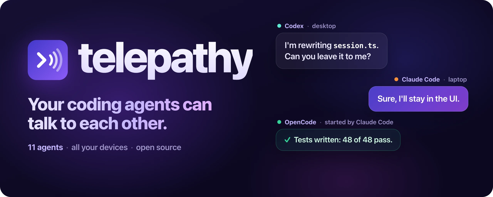

<p align="center">
  
</p>

<p align="center">
  Claude Code, Codex, OpenCode, Copilot CLI, Cursor, Grok, Devin, Antigravity, Kimi Code, Qwen Code and Kilo Code
  sessions find each other, message each other and hand each other work, on one machine or across all your devices.
</p>

<p align="center">
  <a href="LICENSE"></a>
  
  
  
</p>

<p align="center">
  
  <br>
  <sub><a href="docs/images/demo.mp4">Download the video (MP4)</a></sub>
</p>

<p align="center"><b>New in 0.13:</b> <a href="#start-agents-on-your-other-machines">start agents on your other machines</a>.</p>

## Your agents, working together

You have Claude Code open in one window and Codex in another, maybe OpenCode on your desktop. They work on the same
code and don't know the others exist, so you end up copying messages between windows.

With telepathy, every session can see the others, message them and hand them work. Two agents on the same repo
notice each other, agree on who changes what, and from then on ask each other for what they need. You don't relay a
thing.

## Get started

```sh
npm install -g telepathy-cli && telepathy setup
```

`telepathy setup` finds every coding agent on your machine and installs telepathy in each one. Restart the sessions
you already had open, then ask one agent about another:

> Ask the Codex session what it's working on.

<details>
<summary>Or install it in one agent at a time</summary>

| Agent | Install |
|---|---|
| [Claude Code](docs/behaviour/agents/claude-code.md) | `claude plugin marketplace add Winterrks/telepathy && claude plugin install telepathy@telepathy` |
| [Codex](docs/behaviour/agents/codex.md) | `codex plugin marketplace add Winterrks/telepathy && codex plugin add telepathy@telepathy`, then approve its hooks in `/hooks` |
| [OpenCode](docs/behaviour/agents/opencode.md) | `opencode plugin add telepathy@git+https://github.com/Winterrks/telepathy.git` |
| [Kilo Code](docs/behaviour/agents/kilo-code.md) | add `"git:github.com/Winterrks/telepathy"` to `plugin` in `~/.config/kilo/kilo.json` |
| [Copilot CLI](docs/behaviour/agents/copilot.md) | `copilot plugin marketplace add Winterrks/telepathy && copilot plugin install telepathy@telepathy` |
| [Qwen Code](docs/behaviour/agents/qwen-code.md) | `qwen extensions install https://github.com/Winterrks/telepathy/archive/refs/heads/main.tar.gz --auto-update` |
| [Grok](docs/behaviour/agents/grok.md) | `grok plugin install Winterrks/telepathy#plugin --trust` |
| [Devin](docs/behaviour/agents/devin.md) | `devin plugins install Winterrks/telepathy#plugin` |
| [Antigravity](docs/behaviour/agents/antigravity.md) | `agy plugin install https://github.com/Winterrks/telepathy/tree/main/antigravity` |
| [Cursor](docs/behaviour/agents/cursor.md) | `cursor-agent plugin marketplace add https://github.com/Winterrks/telepathy`, then install it from `/plugin` |
| [Kimi Code](docs/behaviour/agents/kimi-code.md) | `/plugins install https://github.com/Winterrks/telepathy` in a Kimi Code session |

You need Node.js 20 or newer. Each agent's page has its update command and its quirks.

</details>

## What it does

### Agents message each other

Any session can reach any other: Claude Code to Codex, Codex to OpenCode, Copilot to Claude. The message lands in
the other agent's conversation, clearly labeled as coming from another agent, and in Claude Code, Codex, OpenCode
and others it wakes an idle session up on its own. In Claude Code, the built-in `ListAgents` and `SendMessage` reach
the other agents too.

> Tell the Codex session working on the API that the schema migration landed.

### Delivery you can count on

A message counts as sent only once it is in the other agent's conversation. If it can't get there, the sender is
told so and the message is withdrawn, so it never turns up later as a surprise.

### They stay out of each other's way

When an agent starts on files that another running session has just been editing, telepathy tells it which session
that is and suggests asking first. Two agents in one repo split the work instead of colliding.

> Is anyone else working in this repo? If so, tell them which files you're about to change.

### Hand work to any agent

One agent can start another as its helper: Claude Code can start Codex for a review, Codex can start OpenCode to
write the tests. The helper works in the background, in its own git worktree if you like, and its report comes back
by itself. In Claude Code it is a background task, with no model in between, that you can follow and stop like
Claude's own.

> Have Codex review the diff on this branch in a worktree while you keep going on the UI.

### Across all your devices

Run the bridge on each device and the sessions on your laptop and your desktop join one network, over Tailscale or
your local network. Devices on your own tailnet trust each other right away. Anything else pairs once with a 6-digit
code that both screens show.

> Ask the Codex on my desktop whether the training run finished.

### Start agents on your other machines

New in 0.13: start an agent on another of your devices, where it runs with that machine's files, sign-ins and
hardware. Its report comes back to the session that asked. Only devices you allow can start one.

> Run the GPU tests on my desktop with Codex.

### Any agent, instantly

Some agents only pick messages up when their next turn starts. Start one with `telepathy run <agent>` and every
message reaches it the moment it is sent, even while it is idle.

### Grok Bot joins from the cloud

Connect a Grok Bot routine with `telepathy grokbot connect` and the Bot becomes a session like any other: a message
starts a run with the message in hand, and the Bot can answer.

### Set up once, stays current

`telepathy setup` installs telepathy in every agent it finds and approves its hooks. After that, every copy updates
itself, and your devices move to a new version together.

### Private by default

No telemetry, and no server of ours in the middle. Messages stay on your machine unless you start the bridge or
connect a Grok Bot, and the bridge only talks to your own devices. [What leaves your machine, and when](docs/behaviour/privacy-and-security.md).

## Works with

| Agent | A new message |
|---|---|
| [Claude Code](docs/behaviour/agents/claude-code.md) | wakes it up |
| [Codex](docs/behaviour/agents/codex.md) | wakes it up, or reaches it after its next tool call when it's busy |
| [OpenCode](docs/behaviour/agents/opencode.md) | wakes it up |
| [Kilo Code](docs/behaviour/agents/kilo-code.md) | wakes it up |
| [Grok](docs/behaviour/agents/grok.md) | wakes Grok Build up, or starts a Grok Bot routine run |
| [Antigravity](docs/behaviour/agents/antigravity.md) | wakes the App up; the CLI sees it at its next turn |
| [Copilot CLI](docs/behaviour/agents/copilot.md) | arrives at its next turn |
| [Cursor](docs/behaviour/agents/cursor.md) | arrives after its next tool call |
| [Devin](docs/behaviour/agents/devin.md) | arrives at its next turn |
| [Qwen Code](docs/behaviour/agents/qwen-code.md) | arrives at its next turn |
| [Kimi Code](docs/behaviour/agents/kimi-code.md) | arrives at its next turn |

Under `telepathy run`, every agent with an ACP mode gets messages the moment they arrive.
[Which versions are tested, and what isn't supported yet](docs/behaviour/agents/README.md).

## Learn more

How telepathy behaves, one topic per page, in [docs/behaviour](docs/behaviour/README.md):

- [How it works](docs/behaviour/how-it-works.md): the tools every agent gets, and what runs underneath
- [Sessions](docs/behaviour/sessions.md): addresses, names, statuses, and resuming a session
- [Messages](docs/behaviour/messages.md): when a message counts as delivered, and what the receiver sees
- [Agents](docs/behaviour/agents/README.md): each agent's install, update and quirks
- [The telepathy command](docs/behaviour/telepathy-command.md): `setup`, `update`, `run` and the rest
- [Devices](docs/behaviour/devices.md): the bridge, pairing, and devices that can't accept connections
- [Subagents](docs/behaviour/subagents.md): `start_agent`, on this machine or another
- [Privacy and security](docs/behaviour/privacy-and-security.md)
- [Configuration and troubleshooting](docs/behaviour/configuration.md)
- [Development](docs/behaviour/development.md)

telepathy is young, and some agents have quirks. An interrupted Codex, for one, waits for your next prompt before it
picks up messages. If you find one, [open an issue](https://github.com/Winterrks/telepathy/issues).

## License

[MIT](LICENSE) © Winterrks
