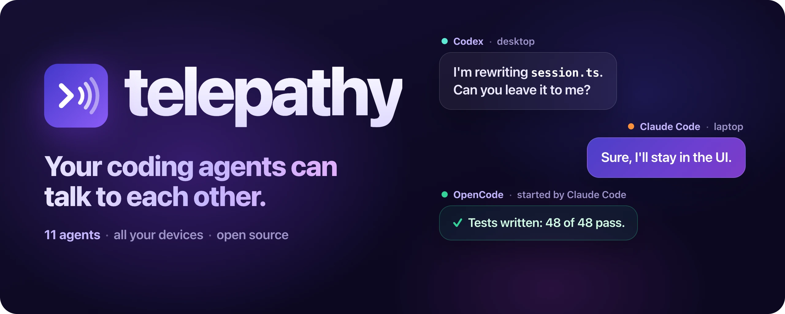

<p align="center">
  
</p>

# telepathy-cli

Your coding agents can talk to each other. Claude Code, Codex, OpenCode, Copilot CLI, Cursor, Grok, Devin,
Antigravity, Kimi Code, Qwen Code and Kilo Code sessions find each other, message each other and hand each other
work, on one machine or across all your devices.

```sh
npm install -g telepathy-cli && telepathy setup
```

`telepathy setup` finds every coding agent on your machine, installs telepathy in each one and approves its hooks.
Restart the sessions you already had open, then ask one agent about another:

> Ask the Codex session what it's working on.

## What you get

- **Agents message each other.** Any session reaches any other, and in most agents a message wakes an idle session
  up on its own.
- **Hand work to any agent.** One agent starts another as its helper, and the report comes back by itself.
- **All your devices.** `telepathy bridge start` joins the sessions on your laptop and desktop, over Tailscale or
  the local network. From 0.13 an agent can start another on a different device, once that device allows it.
- **Any agent, instantly.** `telepathy run <agent>` hosts an agent so every message reaches it the moment it is sent.
- **Stays current.** Every installed copy updates itself, and your devices move to a new version together.
- **Private.** No telemetry. Messages stay on your machines unless you start the bridge or connect a Grok Bot.

`telepathy --help` lists every command: `setup`, `update`, `status`, `doctor`, `install`, `config`, `run`, `ps`,
`stop`, `bridge` and `grokbot`. Node 20 or newer.

More at [github.com/Winterrks/telepathy](https://github.com/Winterrks/telepathy), and how it all behaves in
[docs/behaviour](https://github.com/Winterrks/telepathy/tree/main/docs/behaviour).

The version matches the plugin (`0.14.1` until the plugin version changes). One number, so a CLI and the plugin it
updates are the same release. The plugin package in the repository root stays `telepathy` and `private`, which is
what OpenCode installs from git; this package is the one published to npm.
